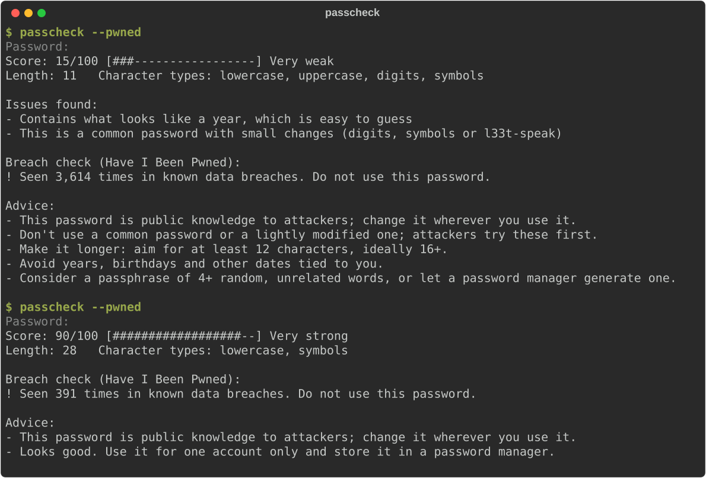

# PassCheck

**Password strength checker** for the command line, with a privacy-preserving breach check.

[](https://github.com/yshxrkz/PassCheck/actions/workflows/ci.yml)
[](https://github.com/yshxrkz/PassCheck/actions/workflows/codeql.yml)


## Overview

PassCheck scores a password from 0 to 100, explains what makes it weak, and tells you how
to fix it. It looks for the things real password-cracking tools try first: short length,
low character variety, common passwords (including disguised ones like `P@ssw0rd!`),
sequences like `123` or `abc`, keyboard walks like `qwerty`, repeats and years.

Strength alone isn't enough, though: a password can look strong and still be in every
attacker's wordlist because it leaked in a breach. With `--pwned`, PassCheck also checks the
[Have I Been Pwned](https://haveibeenpwned.com/Passwords) corpus of hundreds of millions of
breached passwords, using **k-anonymity**, so neither the password nor even its full hash ever
leaves your machine.

## Features

- **0–100 score with a label** (Very weak → Very strong) and prioritised, specific advice
- **Pattern detection:** sequences, keyboard walks (rows, reversed rows and columns such
  as `1qaz2wsx`), repeated characters and chunks, years, common and l33t-speak variants
- **Optional breach check** against Have I Been Pwned via the k-anonymity range API, with
  response padding enabled
- **Safe by default:**
  - the password is read from a hidden prompt or stdin, never from argv (which would leak
    into shell history and `ps`)
  - output never quotes pieces of the password unless you pass `--reveal`, so it's safe
    to log
  - input is capped at 1,024 characters
- **Scriptable:** `--json` output, `--min-score` threshold and meaningful exit codes
- **No runtime dependencies:** pure Python standard library, Python 3.9+
- **Docker image** that runs as a non-root user
- **Tested:** unit, CLI and end-to-end tests on Python 3.9–3.13 with a coverage floor of
  95%, plus ruff (including its bandit security rules), `mypy --strict` and CodeQL in CI

## Example output



The second run shows why the breach check matters. *correct horse battery staple* is a
long, strong-looking passphrase, but it's the famous example from
[xkcd #936](https://xkcd.com/936/), so it's in breach corpora and on attackers' lists.
PassCheck fails it (exit status 1) despite the 90/100 score.

The same check as JSON, for scripts:

```console
$ printf '%s\n' 'Summer2024!' | passcheck --stdin --pwned --json
{
  "score": 15,
  "label": "Very weak",
  "length": 11,
  "character_classes": ["lowercase", "uppercase", "digits", "symbols"],
  "findings": [
    {"kind": "year", "message": "Contains what looks like a year, which is easy to guess"},
    {"kind": "common-variant", "message": "This is a common password with small changes (digits, symbols or l33t-speak)"}
  ],
  "advice": [
    "Don't use a common password or a lightly modified one; attackers try these first.",
    "Make it longer: aim for at least 12 characters, ideally 16+.",
    "Avoid years, birthdays and other dates tied to you.",
    "Consider a passphrase of 4+ random, unrelated words, or let a password manager generate one."
  ],
  "pwned": {"breached": true, "count": 3614},
  "pwned_error": null,
  "passes": false
}
```

(The real output is indented one item per line; it's compacted here to save space.)

## Install

Requires Python 3.9 or newer. There are no runtime dependencies.

```bash
# With pipx (recommended for CLI tools: isolated, puts `passcheck` on your PATH)
pipx install git+https://github.com/yshxrkz/PassCheck

# Or from a clone
git clone https://github.com/yshxrkz/PassCheck && cd PassCheck
pip install .

# Or run straight from the clone without installing
python -m passcheck
```

### Docker

```bash
docker build -t passcheck .
docker run --rm -it passcheck            # hidden interactive prompt
docker run --rm -it passcheck --pwned    # plus the breach check
```

`-it` is needed for the interactive prompt. To pipe a password in, use `-i` and `--stdin`:

```bash
printf '%s\n' "$PW" | docker run --rm -i passcheck --stdin --json
```

## Usage

```bash
passcheck                    # prompts for the password (input hidden)
passcheck --pwned            # also check Have I Been Pwned
passcheck --json             # machine-readable output
passcheck --min-score 80     # stricter pass/fail threshold (default 60)
passcheck --reveal           # show which parts matched a pattern, e.g. '123'
printf '%s\n' "$PW" | passcheck --stdin    # read from stdin, e.g. in scripts
```

| Option | Description |
|--------|-------------|
| `--stdin` | Read the password from the first line of standard input instead of prompting |
| `--pwned` | Also check Have I Been Pwned (only a 5-character hash prefix is sent) |
| `--min-score N` | Exit with status 1 if the score is below `N` (0–100, default 60) |
| `--json` | Print the result as JSON |
| `--reveal` | Quote the matched parts of the password in findings. Off by default so output is safe to log |
| `--version` | Print the version |

The password is deliberately **not** accepted as a command-line argument: arguments are
saved in shell history and visible to other users through `ps`.

### Exit codes

| Code | Meaning |
|------|---------|
| 0 | Score is at least `--min-score` and (with `--pwned`) the password wasn't found in a breach |
| 1 | Score is below `--min-score`, or the password was found in a breach |
| 2 | Usage error: no password, password over 1,024 characters, or an invalid option |
| 130 | Interrupted with Ctrl-C |

If the breach check can't reach the API, PassCheck prints a warning to stderr, reports
`"pwned": null` and `"pwned_error"` in JSON, and falls back to the offline result instead of
failing.

### Using it in a script

```bash
if ! printf '%s\n' "$NEW_PASSWORD" | passcheck --stdin --pwned --min-score 70 >/dev/null; then
    echo "Please choose a stronger password." >&2
    exit 1
fi
```

## How it works

```
                  ┌──────────────────────────── passcheck/cli.py ─────────────────────────────┐
 hidden prompt ──►│ read_password ──► check_password ──► render_text / render_json ──► stdout │
   or --stdin     └─────────────────────────┬──────────────────┬──────────────────────────────┘
                                            │                  │ only with --pwned
                                            ▼                  ▼
                         passcheck/strength.py          passcheck/hibp.py
                         analyze(): detectors,          pwned_count(): SHA-1 locally,
                         score, advice (offline)        send 5-char prefix, match locally
```

The code is split so each part can be tested on its own. `strength.py` is pure functions
with no I/O. `hibp.py` takes the network call as a parameter (`fetcher`), so tests swap in a
fake one. `cli.py` takes its input and output streams as parameters, so tests drive it
without a terminal.

### What it checks

| Check | Examples | Effect on the score |
|-------|----------|---------------------|
| Length | under 8 characters | capped at 30; advice to reach 12–16+ |
| Character variety | lowercase, uppercase, digits, symbols | up to 20 points; using only one class is penalised |
| Common passwords | `123456`, `letmein`, `iloveyou` | score 0 |
| Disguised common passwords | `Password123!`, `m0nk3y`, `dragon2024` | capped at 15 |
| Sequences | `abc`, `123`, `987`, `xyz` | those characters count for ¼ |
| Keyboard walks | `qwerty`, `asdf`, `poiuy`, `1qaz2wsx` | those characters count for ¼ |
| Repeats | `aaa`, `abcabc` | those characters count for ¼ |
| Years | `1987`, `2024` | −5 |

**Scoring.** Up to 80 points come from the *effective length* (4 points per character, up
to 20 characters). Characters inside a detected pattern count for only a quarter, because
cracking tools try those patterns early. Up to 20 more points come from character variety.
Then the caps for short and common passwords apply. Labels: 0–19 Very weak, 20–39 Weak,
40–59 Fair, 60–79 Strong, 80–100 Very strong.

**Disguised common passwords** are found by stripping leading and trailing digits and
symbols (`Password123!` → `password`) and undoing l33t-speak (`p@$$w0rd` → `password`),
then looking the result up in the bundled list.

This is a heuristic. It catches the common mistakes, but it can't know that a password is
your dog's name. Length and randomness matter most, so a password manager or a passphrase
of several random words is the best advice in nearly every case.

### The breach check and why k-anonymity protects you

Have I Been Pwned (HIBP) keeps a list of hundreds of millions of real passwords exposed in
data breaches. If yours is on it, attackers have it in their wordlists, however strong it
looks. The difficulty is checking the list without handing your password to anyone.

#### What PassCheck sends

1. It hashes your password locally with SHA-1:
   `password` → `5BAA61E4C9B93F3F0682250B6CF8331B7EE68FD8`
2. It sends **only the first 5 hex characters** of that hash:
   `GET https://api.pwnedpasswords.com/range/5BAA6`
3. HIBP replies with the remaining 35 characters of **every** breached hash that starts
   with `5BAA6`, usually 800–1,000 of them, each with a count:
   ```
   ...
   1E4C9B93F3F0682250B6CF8331B7EE68FD8:9545824
   ...
   ```
4. PassCheck looks for its own 35-character suffix in that list **on your machine**.

Your password, the full hash, and the 35-character suffix never leave your computer. The
test suite enforces this: `tests/test_hibp.py` intercepts the outgoing HTTP request and
fails if anything beyond the 5-character prefix appears in the URL or headers.

#### Why the prefix gives nothing away

* **The prefix is shared by a crowd.** 5 hex characters allow only 16⁵ = 1,048,576
  prefixes. Every possible password falls into one of these buckets, so each bucket covers
  an enormous number of possible passwords and hundreds of known breached ones. The server
  learns which bucket you asked about, and that bucket is shared by far too many
  candidates to single out your password. This is what *k-anonymity* means: your query
  can't be told apart from those of at least *k* others. Here *k* is in the hundreds even
  counting breached passwords alone, and effectively unbounded counting every possible one.
* **The server never learns the answer.** The match happens locally, so HIBP can't tell
  whether your password was in the list, let alone which entry it was. The request looks
  exactly the same either way.
* **Response padding hides the bucket size.** PassCheck sends the `Add-Padding: true`
  header, so HIBP pads each response with dummy entries (count 0, ignored by PassCheck).
  Every response is then a similar size, and someone watching the encrypted traffic can't
  guess the prefix from how much data came back.
* **Nothing to steal in transit or at rest.** Even if the request were logged by HIBP, a
  proxy, or an attacker, a 5-character prefix can't be reversed into a password. It only
  narrows the search by a factor of about one million, which is negligible next to the
  size of the space of possible passwords.

Without k-anonymity, the alternative would be sending the full SHA-1 hash. That is nearly
as bad as sending the password: unsalted SHA-1 is fast to compute, so any password a human
would pick can be recovered from its hash with a dictionary attack in seconds.

What k-anonymity does *not* hide: that you (your IP address) made a request to HIBP at a
particular time. The breach check is off by default; it only runs with `--pwned`.

### Security design

| Risk | Mitigation |
|------|------------|
| Password leaking via shell history or `ps` | Never accepted as an argument; hidden prompt or `--stdin` only |
| Password fragments leaking into logs | Findings describe patterns by type and length; fragments only with `--reveal` |
| Password or full hash sent over the network | Only a validated 5-character hash prefix is sent; enforced by tests |
| Response-size side channel | `Add-Padding: true` on every request |
| Tampered, spoofed or downgraded responses | TLS with certificate verification; non-HTTPS URLs and redirects refused; every response line validated |
| Memory or CPU exhaustion from huge input or responses | Password capped at 1,024 characters with a bounded stdin read; API response capped at 1 MiB |
| Container escape impact | Docker image runs as an unprivileged user, base image pinned by digest |
| Unnoticed vulnerable code or dependencies | ruff bandit rules and CodeQL in CI; Dependabot for actions, the base image and pip |

## Development

```bash
python -m venv .venv && . .venv/bin/activate
pip install -e '.[dev]'

pytest --cov          # none of the tests touch the network
ruff check .          # lint, including bandit security rules
ruff format --check . # formatting
mypy                  # strict type-checking
```

CI (`.github/workflows/ci.yml`) runs the same checks on every push and pull request,
runs the tests on Python 3.9–3.13, and builds and smoke-tests the Docker image. CodeQL runs
on every push, every pull request and weekly.

### Project layout

```
passcheck/
  strength.py                  offline analysis: detectors, scoring, advice
  hibp.py                      k-anonymity Pwned Passwords client
  cli.py                       argument parsing, input, output, exit codes
  data/common_passwords.txt    bundled common-password list
tests/
  test_strength.py             detectors and scoring
  test_hibp.py                 hashing, parsing, error handling, k-anonymity guarantee
  test_cli.py                  options, output, redaction, error paths
  test_e2e.py                  runs `python -m passcheck` in a subprocess
docs/example-output.svg        the screenshot above (a real run)
Dockerfile                     multi-stage, non-root image
```

## Limitations

- The bundled common-password list is short (about 160 entries) so that the tool stays
  small. The breach check is the thorough test. For an offline check against a bigger list,
  replace `passcheck/data/common_passwords.txt`.
- The keyboard-walk detector knows the US QWERTY layout only.
- The score is a heuristic, not a measured crack time. For an entropy model based on real
  attack data, see [zxcvbn](https://github.com/dropbox/zxcvbn).

## What I learned

- **Privacy can be designed into a protocol.** k-anonymity lets you ask "is my password in
  this list?" without revealing the password. Splitting the hash into a public prefix and a
  private suffix answers the question just as well as sending everything.
- **A tool that handles secrets can leak them in unexpected places.** Beyond the network,
  I had to think about shell history, `ps`, and the tool's own output: an early version
  quoted the matched fragments (`'123'`, `'qwerty'`) in its findings, which would have put
  pieces of passwords into CI logs.
- **Strength is more than complexity rules.** `Password123!` satisfies the usual "upper,
  lower, digit, symbol" rules and is still one of the first guesses an attacker makes.
  Length and unpredictability matter far more than character classes.
- **Untrusted input includes the network.** The API client validates every line it receives,
  caps the response size and refuses non-HTTPS URLs, and the CLI caps input length after
  measuring that analysis time grows quadratically with it.
- **Design for testability.** Passing the network call and the I/O streams in as parameters
  made it possible to test every error path, and the privacy guarantee itself, without a
  network or a terminal.
- **CI as a safety net:** linting, strict typing, a test matrix across Python versions,
  CodeQL and a container smoke test catch problems before they reach `main`.
